

  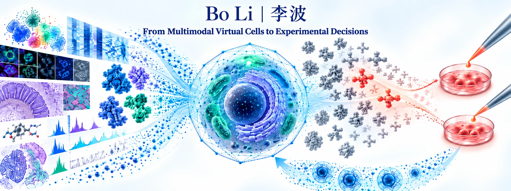

  🧬 <strong>Multimodal Virtual Cells</strong> &nbsp;·&nbsp;
  🔬 <strong>Perturbation Modeling</strong> &nbsp;·&nbsp;
  💊 <strong>Intervention Design</strong>

  <a href="https://boom5426.github.io/">🏠 Homepage</a> &nbsp;·&nbsp;
  <a href="https://scholar.google.com/citations?hl=zh-CN&user=y1myk_IAAAAJ&view_op=list_works&sortby=pubdate">📚 Google Scholar</a> &nbsp;·&nbsp;
  <a href="https://orcid.org/0000-0003-0608-1502">🆔 ORCID</a> &nbsp;·&nbsp;
  <a href="mailto:19919920960@163.com">✉️ Email</a> &nbsp;·&nbsp;
  <a href="./WeChat.png">💬 WeChat</a>

 

### 📊 Scholar Profile · 学术画像

  <a href="https://raw.githack.com/Boom5426/Boom5426/main/scholar-profile/report_en.html">
    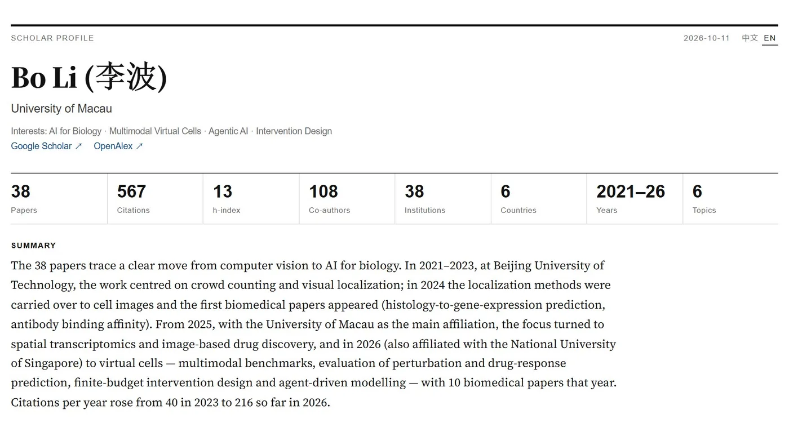
  </a>

  <a href="https://raw.githack.com/Boom5426/Boom5426/main/scholar-profile/report_en.html">🔍 Interactive report (EN)</a> &nbsp;·&nbsp;
  <a href="https://raw.githack.com/Boom5426/Boom5426/main/scholar-profile/report.html">🔍 交互版报告（中文）</a>

<b>Figures</b> — collaboration network, research evolution, paper–topic network, institutions

 

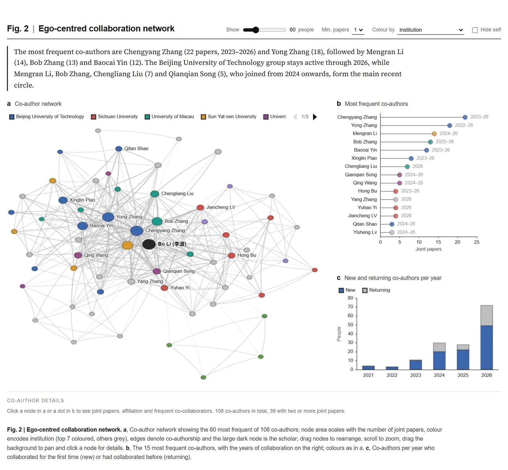

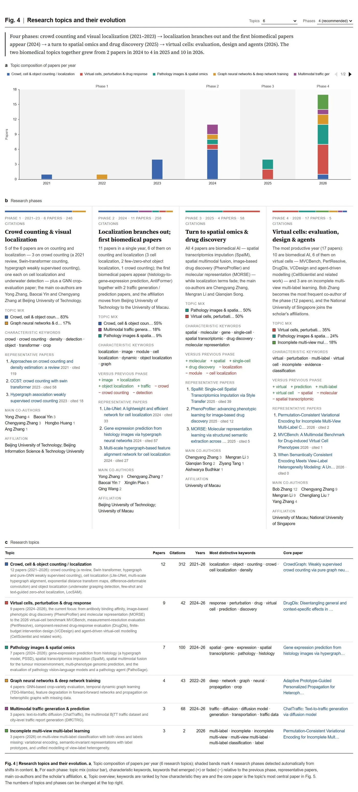

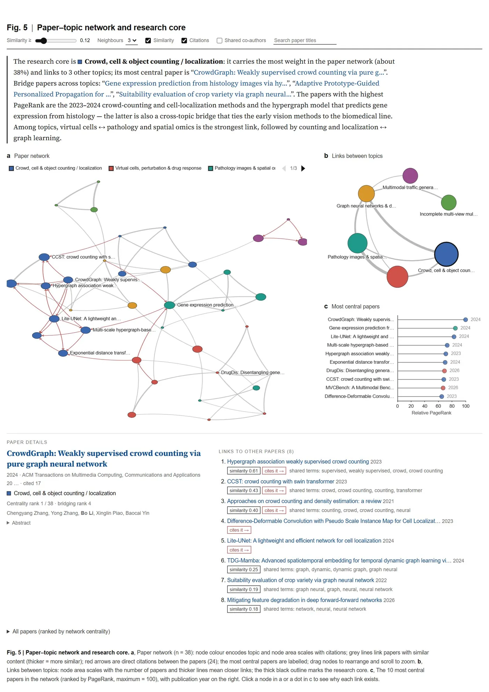

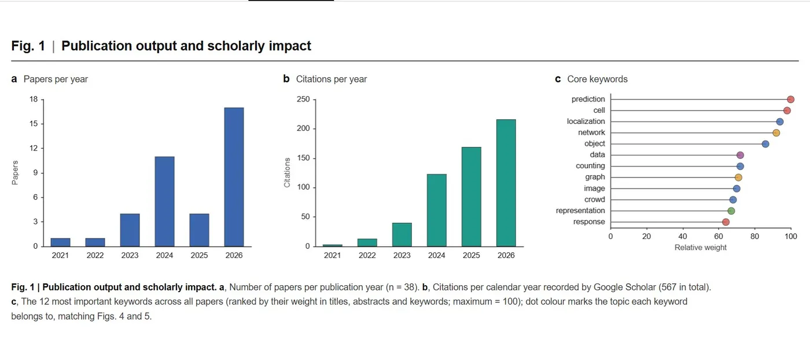

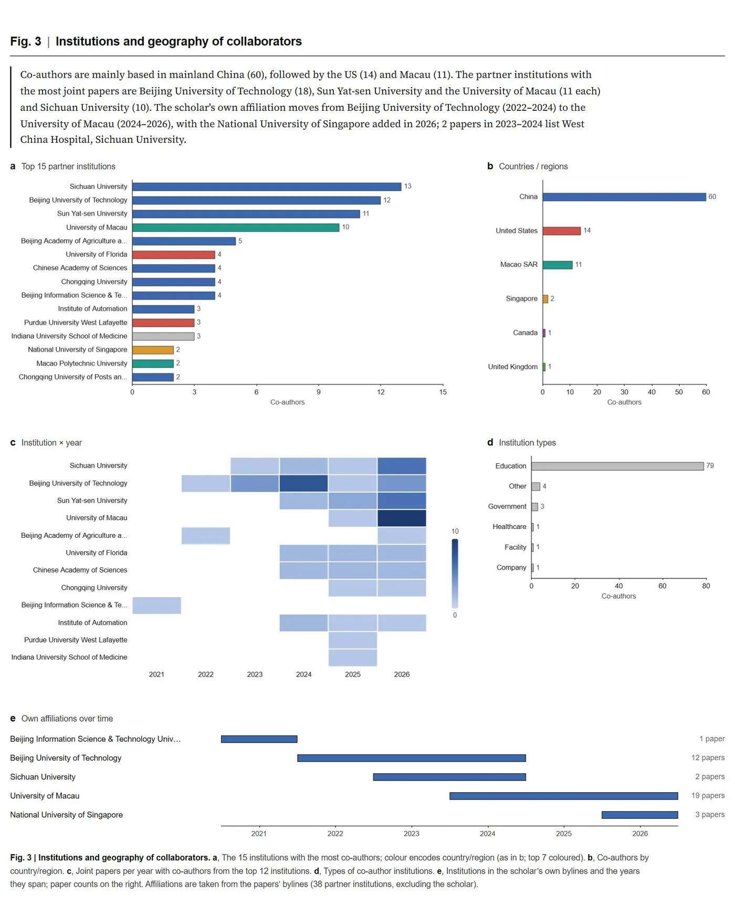

<b>图表（中文）</b> — 合作网络、研究演化、论文主题网络、合作机构

 

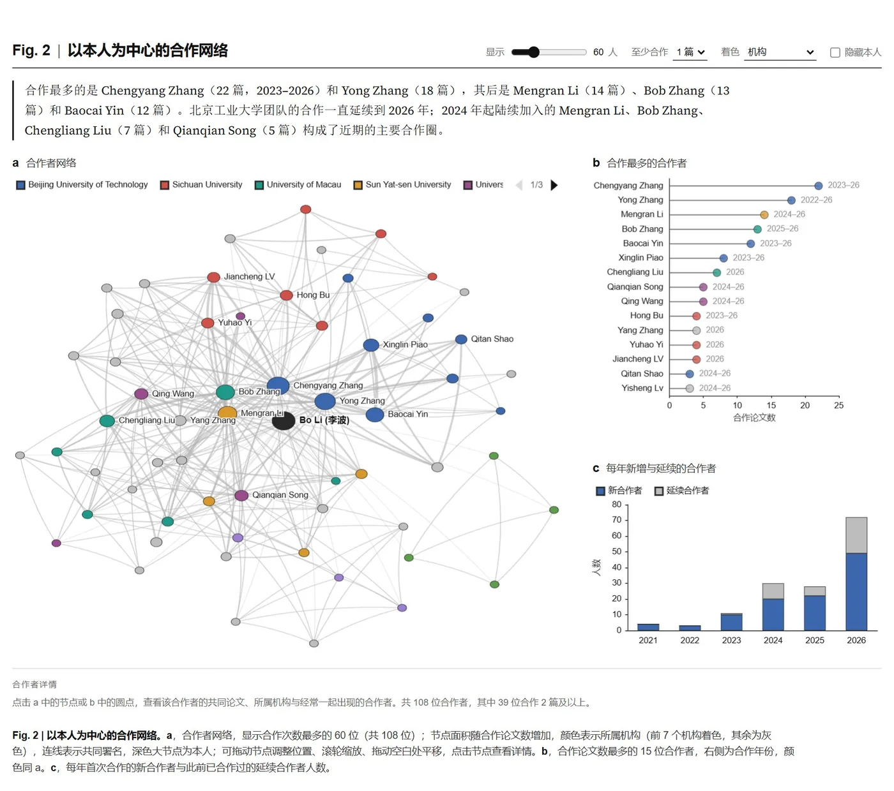

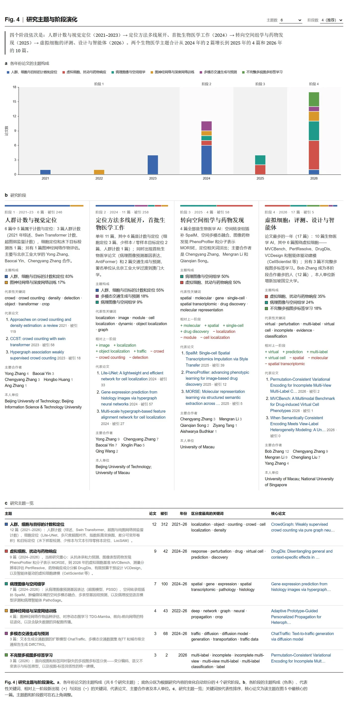

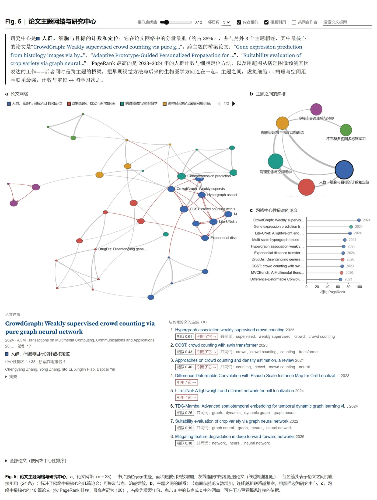

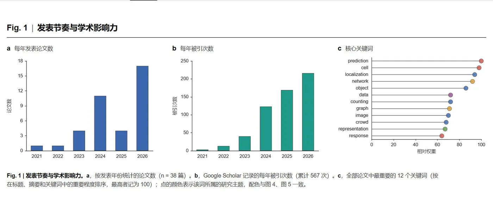

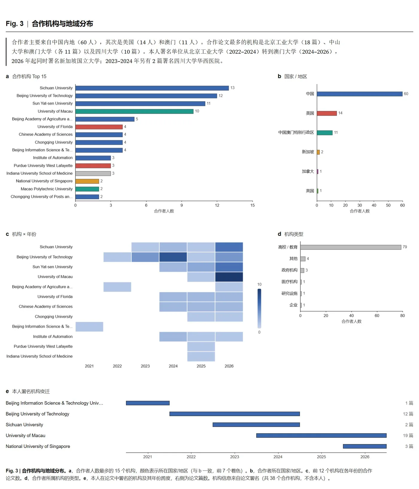

Built from Google Scholar and OpenAlex with <a href="https://github.com/wq2581/scholar-tracing">scholar-tracing</a> · updated 2026-10-11

