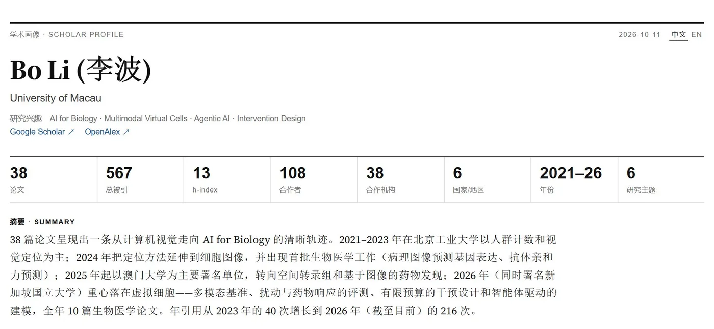

# Scholar Profile · 学术画像

Co-authors, institutions, research topics and how they evolved, built from Google Scholar, OpenAlex and the manuscripts on [my homepage](https://boom5426.github.io/) (updated 2026-10-11).

**Interactive version:** download [`report_en.html`](./report_en.html) (English) or [`report.html`](./report.html) (中文) and open it in a browser. Both pages have a 中文 / EN switch.

More: Fig. 1 Output and impact · Fig. 3 Institutions

中文版图表

Generated with <a href="https://github.com/wq2581/scholar-tracing">scholar-tracing</a>.
